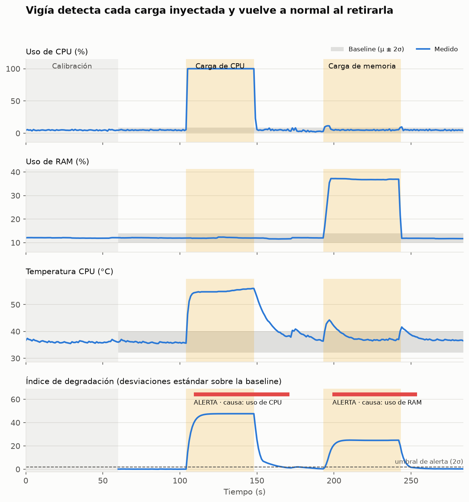

# Vigía

Daemon local para Linux que modela el rendimiento normal de un sistema
(su *baseline*), detecta cuándo se degrada y señala la causa probable.
No usa la red en ningún momento.

Proyecto de la materia **Modelado y Simulación**. Estado: **avance (fase 0)**.



## Qué demuestra la gráfica

Es un experimento controlado: se calibra la baseline con el sistema en
reposo, se inyectan dos cargas conocidas y se observa qué detecta Vigía.

| Carga inyectada | Inicio | Alerta de Vigía | Causa atribuida | Fin de la alerta |
|---|---|---|---|---|
| CPU (16 hilos, 45 s) | 104 s | 109 s (+5 s) | uso de CPU | 23 s después de retirar la carga |
| Memoria (≈8 GB, 45 s) | 193 s | 199 s (+6 s) | uso de RAM | 11 s después de retirar la carga |

- Las dos cargas se detectaron y se atribuyeron a la causa correcta.
- No hubo alertas fuera de los periodos de carga.
- La alerta de CPU tarda más en apagarse porque la temperatura sigue alta
  un rato después de quitar la carga (inercia térmica); el índice lo refleja.

Los datos de esta corrida están en `data/demo.csv`.

## El modelo

Para cada métrica `x`, durante la calibración se calculan su media `μ` y
su desviación estándar `σ`. Después, en cada muestra:

| Paso | Fórmula | Para qué |
|---|---|---|
| Desviación normalizada | `z = (x − μ) / σ` | Qué tan lejos de lo normal está la métrica |
| Suavizado (EWMA) | `s_t = α·z_t + (1−α)·s_{t−1}`, `α = 0.3` | Ignorar picos aislados |
| Índice de degradación | `D = max(s_i, 0)` | Un solo número: la peor métrica en ese momento |
| Causa probable | la métrica `i` con mayor `s_i` | Explicar el porqué |
| Alerta | `D ≥ 2` durante 5 muestras seguidas | Avisar solo si la desviación se sostiene |

Dos detalles del modelo:

- **Piso de σ.** Un sistema en reposo es tan estable que `σ` puede ser casi
  cero y cualquier cambio mínimo daría una `z` enorme. Cada métrica tiene un
  `σ` mínimo (por ejemplo, 2 puntos porcentuales para CPU y 2 °C para
  temperatura).
- **Histéresis.** La alerta se apaga con la misma regla con la que se
  enciende (5 muestras seguidas bajo el umbral), para que no parpadee.

## Métricas actuales

| Métrica | Fuente |
|---|---|
| Uso de CPU | `/proc/stat` |
| Uso de RAM y swap | `/proc/meminfo` |
| Temperatura de CPU | `/sys/class/hwmon` |
| Presión de CPU, memoria y E/S (PSI) | `/proc/pressure/*` |
| Latencia de respuesta (retraso al despertar de un sleep de 10 ms) | medición propia |

Si una fuente no existe en el equipo, esa métrica se omite y el daemon
sigue funcionando con las demás.

## Uso

Requisitos: `gcc`, `make` y, para la gráfica, Python con `matplotlib`.

```sh
make                # compila build/vigiad y build/loadgen
make demo           # corre el experimento (~5 min) y genera docs/demo.png
```

Durante `make demo` hay que dejar el equipo en reposo. Si `matplotlib` no
está instalado en el sistema:

```sh
python3 -m venv .venv && .venv/bin/pip install matplotlib
```

Ejecutar el daemon a mano:

```sh
./build/vigiad -i 5000 -c 720 -o datos.csv
```

| Opción | Significado | Valor por defecto |
|---|---|---|
| `-i` | Intervalo de muestreo en milisegundos | 5000 |
| `-c` | Muestras usadas para calibrar la baseline | 720 (una hora) |
| `-n` | Detenerse tras este número de muestras | 0 (sin límite) |
| `-o` | Archivo CSV de salida | salida estándar |

## Estructura

| Ruta | Contenido |
|---|---|
| `src/collect.c` | Colectores de métricas |
| `src/baseline.c` | El modelo: baseline, z, EWMA, índice, alerta |
| `src/vigiad.c` | Ciclo principal del daemon |
| `tools/loadgen.c` | Generador de carga para el experimento |
| `scripts/demo.sh` | Experimento controlado |
| `scripts/plot.py` | Gráfica a partir del CSV |

## Diseño

- **C11**, sin dependencias en esta fase. El daemon usa unos 2.5 MB de RAM,
  un solo hilo y no reserva memoria dinámica.
- Compilado con `-march=native` y opciones de endurecimiento (PIE, RELRO,
  protector de pila, `_FORTIFY_SOURCE=3`), con `-Wall -Wextra -Werror`.
- Solo lee archivos de `/proc` y `/sys`. No abre sockets.

## Pendiente

Esta fase todavía **no cifra los datos**: el CSV se escribe en claro.

| Fase | Contenido |
|---|---|
| 1 | Historial cifrado con libsodium (el daemon cifra con clave pública; solo el usuario descifra con su contraseña). Herramienta `vigia` para leer el reporte. Métricas por proceso, disco, throttling y tiempo de arranque. |
| 2 | Reglas de atribución más finas (qué proceso o servicio causó el cambio). Notificación semanal y alerta inmediata. Servicio de systemd aislado (sin red, sin privilegios). GPU opcional. |

Límites conocidos: el experimento dura minutos; falta validar el modelo con
datos de varios días de uso real, donde la baseline debe distinguir el uso
normal de una degradación.

## Licencia

MIT. Ver [LICENSE](LICENSE).
